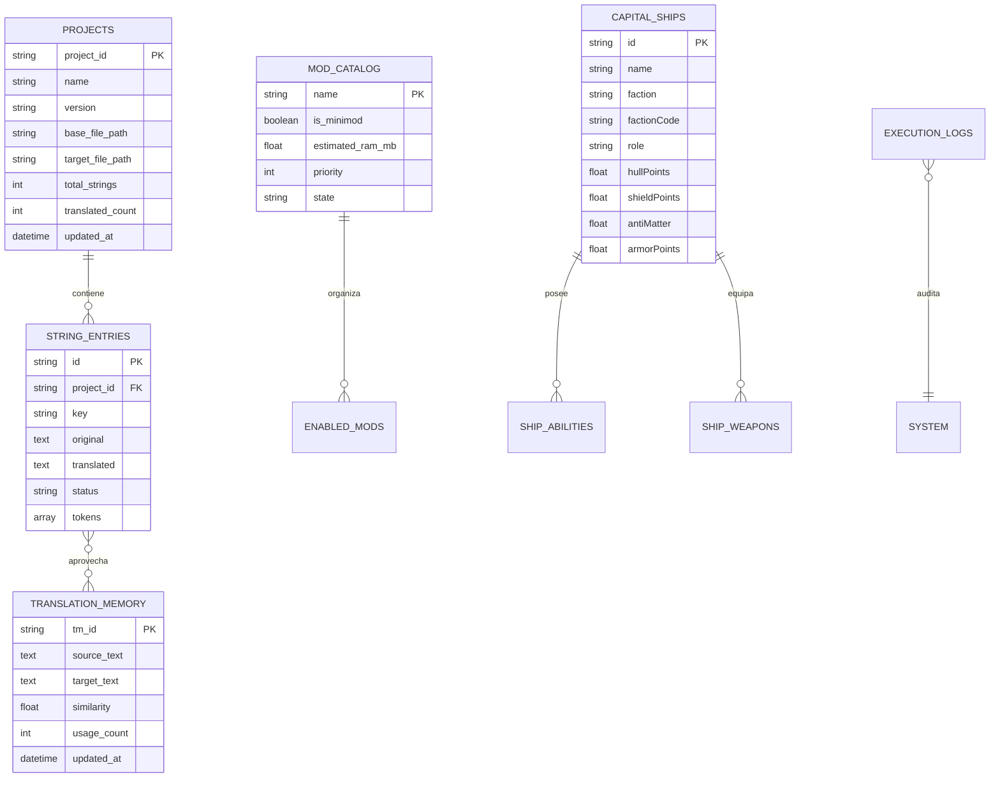

# Arquitectura de Persistencia y Modelado de Datos - Solaris Nexus Studio

## 1. Modelo de Persistencia en Google AI Studio

En el entorno de **Google AI Studio**, Solaris Nexus Studio implementa un modelo de datos estructurado en memoria respaldado por instantáneas atómicas y almacenamiento de respaldo en disco local (`storage/backups/`).

Para escenarios donde se requiera persistencia relacional a gran escala compartida entre sesiones o multiusuario, la plataforma está diseñada para integrarse con **Google Cloud SQL (PostgreSQL)** mediante las herramientas de aprovisionamiento de AI Studio.

---

## 2. Diagrama Entidad-Relación Lógico (ERD)

---

## 3. Entidades y Esquemas Principales

### 3.1 Proyectos de Localización (`tbl_projects`)
Almacena los metadatos de los diccionarios `.str` activos en el espacio de trabajo:
* `project_id` (VARCHAR 64): Identificador alfanumérico o UUID canónico (ej. `sins-rebellion-core`).
* `name` (VARCHAR 255): Nombre visible del proyecto o mod.
* `version` (VARCHAR 64): Versión del motor o mod (ej. `v1.85 Rebellion`).
* `base_file_path` (TEXT): Ruta del archivo original en inglés.
* `target_file_path` (TEXT): Ruta del archivo compilado en español.
* `total_strings` (INTEGER): Número total de entradas esperadas (`NumStrings`).
* `translated_count` (INTEGER): Número de entradas traducidas activamente.
* `updated_at` (DATETIME): Marca temporal ISO 8601 de la última modificación.

### 3.2 Entradas Léxicas (`tbl_string_entries`)
* `id` / `key` (VARCHAR 255): Identificador canónico de la cadena (ej. `IDS_MAIN_MENU_TITLE`).
* `original` (TEXT): Texto original en inglés.
* `translated` (TEXT): Texto traducido al español.
* `status` (ENUM): Estado de la traducción (`TRANSLATED`, `UNTRANSLATED`, `REVIEW`).
* `tokens` (JSON / Array): Lista de tokens detectados por Token Guard (`[VALUE]`, `%s`, etc.).

### 3.3 Banco de Memoria de Traducción (`tbl_translation_memory`)
Mantiene los pares lingüísticos verificados para autopropagación y sugerencias difusas en tiempo real:
* `source_text`: Cadena base indexada.
* `target_text`: Traducción óptima aprobada.
* `similarity`: Puntuación de afinidad porcentual (0-100%).

### 3.4 Historial de Auditoría y Ejecuciones (`tbl_executions`)
* `exec_id` (INTEGER AUTOINCREMENT): Identificador de tarea.
* `exec_type` (VARCHAR 16): Categoría (`SYS`, `STR`, `VFS`, `CLI`, `FS`).
* `description` (TEXT): Resumen de la operación realizada.
* `details` (TEXT NULL): Parámetros o rutas afectadas.
* `result` (VARCHAR 32): Resultado (`OK`, `WARNING`, `ERROR`).
* `created_at` (DATETIME): Marca temporal de la ejecución.

---

## 4. Garantía de Integridad y Resguardos Atómicos

Toda operación de escritura sobre archivos de juego o entidades (`.str`, `.entity`, `EnabledMods.txt`):
1. Genera una copia previa en `storage/backups/` con sello temporal.
2. Escribe en búfer atómico con codificación **UTF-8 con BOM** (`\xEF\xBB\xBF`) y saltos **CRLF** (`\r\n`).
3. Calcula el hash SHA-256 para verificación de consistencia.
